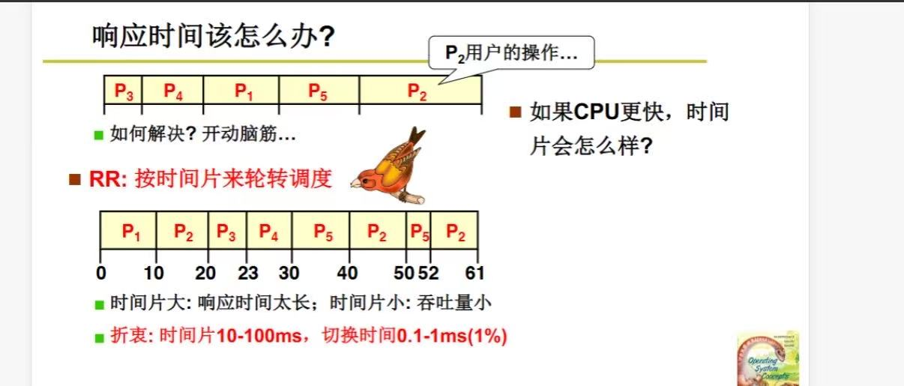

# 计算机科学基础概念可视化探索：CPU进程调度算法演示器
## 项目需求与设计文档

### 一、 项目背景与选题意义
操作系统中的进程调度算法（如FCFS、SJF、RR）是计算机科学的核心基础概念。然而，纯理论的教学往往比较抽象。本项目旨在开发一款轻量级的桌面可视化程序，动态演示不同调度算法的执行过程和甘特图，帮助初学者直观理解进程的排队、执行、周转等概念。

### 二、 功能需求
本程序基于 Python (推荐使用 Tkinter 库) 开发，核心包含以下功能：
1. **参数输入**：用户可动态输入进程的 ID、到达时间、服务时间。
2. **算法选择**：提供 FCFS（先来先服务）、SJF（短作业优先）、RR（时间片轮转）三种算法，支持设置 RR 的时间片大小。
3. **可视化展示**：使用 Canvas 绘制甘特图，用不同颜色的色块表示进程执行，标注时间轴，体现 CPU 空闲状态。
4. **指标计算**：自动计算并展示每个进程的完成时间、周转时间、带权周转时间、等待时间，以及平均指标。

### 三、 可视化方案与技术架构
项目采用前后端分离的思想，模块化开发：
- `main.py`：程序入口，负责初始化。
- `scheduler.py`：核心逻辑层，纯算法实现，返回计算结果。
- `ui.py`：界面表现层，基于 Tkinter 构建，包含数据表格和甘特图画布。

**界面参考原型**：
 

### 四、 团队分工与 Git 协作规范
本项目 5 人团队采用标准的 Git 分支管理流程，严格遵循 `main` 分支保护原则，所有开发均在 `feature/*` 分支进行，通过 Pull Request 合并。

| 成员姓名 | 角色 | 负责分支名 | 具体任务 |
| :--- | :--- | :--- | :--- |
| **[殷樱菡]** | 组长/后端 | `feature/backend-logic` | 负责仓库初始化；主导核心算法 `scheduler.py` 的编写与测试；负责审查 PR 与合并。 |
| **[周熙]** | 前端开发 | `feature/ui-design` | 负责 `ui.py` 美化，优化 Canvas 甘特图绘制逻辑。 |
| **[朱家麟]** | 前端开发 | `feature/ui-interaction` | 负责完善输入区的交互逻辑，处理非法输入的弹窗拦截。 |
| **[黄钰茜]** | 调研与测试 | *(统筹)* | 负责查阅资料提供标准测试用例，程序完成后进行黑盒测试并提 Issues。 |
| **[李奥琪]** | 文档与演示 | `feature/docs` | 负责撰写 README.md，校对最终文档；负责课堂演示主讲。 |

### 五、 Vibe Coding (AI 辅助) 策略
本项目将使用 AI 编程助手（如 Qoder/Cursor）辅助开发。团队成员将使用结构化提示词生成界面代码，并在此过程中记录 AI 的“幻觉”与 Debug 过程，最终整理成 `AI_Prompts_Log.md` 作为结对编程的凭证。

### 六、 预期成果
完成一个可运行的 GUI 程序，包含完整的开源仓库（含 README、设计文档、AI交互日志和代码）。