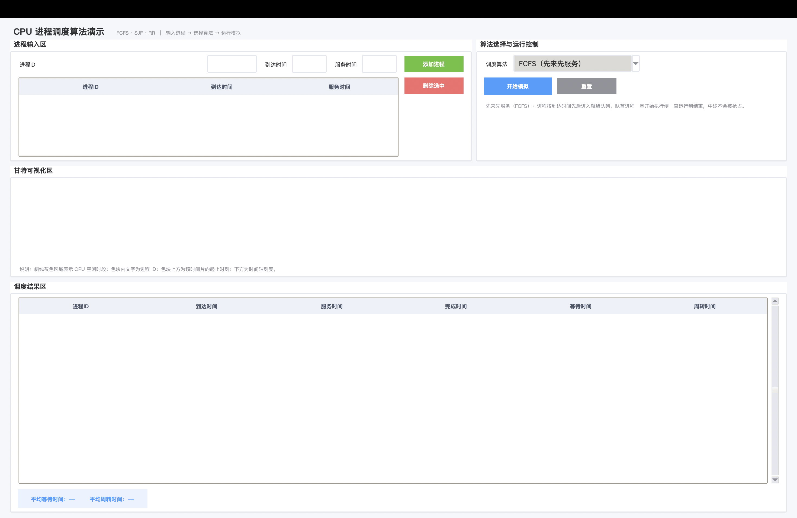

# CPU 进程调度算法可视化系统

> 一款基于 Python + Tkinter 的轻量级桌面应用，将操作系统课程中抽象的进程调度概念转化为直观的**动态甘特图**，帮助初学者轻松理解进程排队、CPU 占用与时间片轮转等核心知识点。

## 项目简介

操作系统中的进程调度算法（FCFS、SJF、RR）是计算机科学的核心基础概念，但纯理论教学往往较为抽象。本项目旨在提供一款**可视化演示工具**，支持以下三种经典调度算法的动态模拟：

- **FCFS（先来先服务）**：按照进程到达时间的先后顺序依次执行，直观展示"先到先得"的排队过程；
- **SJF（短作业优先，非抢占）**：每次从就绪队列中选择**服务时间最短**的进程执行，演示短作业优先策略如何降低平均等待时间；
- **RR（时间片轮转）**：每个进程每次最多连续执行一个**时间片**，时间片耗尽后重新排到就绪队列队尾，直观体现分时系统的公平调度思想。

系统在模拟完成后会自动计算并展示每个进程的**完成时间**、**周转时间**、**带权周转时间**、**等待时间**以及各项**平均指标**，并以不同颜色的色块绘制甘特图、标注时间轴与 CPU 空闲状态，帮助学习者将调度过程"看得见"。

## 功能特性

- **灵活的参数输入**：支持动态添加/删除进程，自由设置进程 ID、到达时间与服务时间；
- **三种调度算法**：一键切换 FCFS、SJF、RR 算法，RR 算法支持自定义时间片大小；
- **可视化甘特图**：使用 Canvas 绘制彩色甘特图，不同颜色区分进程，清晰标注 CPU 空闲段；
- **完整指标统计**：自动计算并展示每个进程的完成时间、周转时间、带权周转时间与等待时间，以及平均周转时间、平均带权周转时间、平均等待时间；
- **健壮的输入校验**：对非法输入（如负数到达时间、非正服务时间）进行弹窗拦截与中文提示。

## 项目结构

```
CPU-Scheduler-GUI/
├── main.py          # 程序入口：初始化窗口并进入 Tk 主循环
├── scheduler.py     # 核心逻辑层：FCFS / SJF / RR 纯算法实现（不依赖界面）
├── ui.py            # 界面表现层：基于 Tkinter 的输入区、结果表格与甘特图画布
└── demo.jpg         # 软件运行截图
```

项目采用**前后端分离**的模块化设计：

- **`scheduler.py`** 作为纯算法模块，不依赖任何界面库，可独立运行测试；
- **`ui.py`** 负责界面渲染与交互，通过调用调度算法获取结果并绘制甘特图；
- **`main.py`** 仅负责入口配置（含 Windows 高分屏 DPI 感知适配）。

## 运行指南

### 环境要求

- **Python 3.7 及以上版本**（`tkinter` 为 Python 标准库，随官方安装包自带，无需额外安装）
- 支持 Windows、macOS、Linux 操作系统

### 启动步骤

1. 克隆项目到本地：

   ```bash
   git clone <仓库地址>
   cd CPU-Scheduler-GUI
   ```

2. 确认 Python 环境可用：

   ```bash
   python --version
   ```

3. 在项目根目录下执行以下命令启动程序：

   ```bash
   python main.py
   ```

启动后即可在图形界面中输入进程参数、选择调度算法并查看甘特图与指标统计结果。

## 软件运行截图



## 团队分工

本项目由 5 人团队协作开发，采用标准的 Git 分支管理流程，所有开发均在 `feature/*` 分支进行并通过 Pull Request 合并至 `main` 分支。

| 成员姓名 | 角色 | 具体分工 |
| :---: | :---: | :--- |
| **殷樱菡** | 组长 / 后端开发 | 负责仓库初始化；主导核心调度算法 `scheduler.py` 的编写与测试；负责 Pull Request 审查与合并 |
| **周熙** | 前端开发 | 负责 `ui.py` 界面美化，优化 Canvas 甘特图绘制逻辑 |
| **朱家麟** | 前端开发 | 负责完善输入区交互逻辑，实现非法输入的弹窗拦截 |
| **黄钰茜** | 调研与测试 | 负责查阅资料、提供标准测试用例；程序完成后进行黑盒测试并提交 Issues |
| **李奥琪** | 文档与演示 | 负责撰写 README.md、校对最终文档；负责课堂演示主讲 |

## 开源协议

本项目基于 **[MIT License](https://opensource.org/licenses/MIT)** 开源协议发布，允许自由使用、复制、修改、合并、发布与再授权，但需在软件副本中保留版权声明与许可声明。

```text
MIT License

Copyright (c) 2026 CPU 进程调度算法可视化系统开发团队

Permission is hereby granted, free of charge, to any person obtaining a copy
of this software and associated documentation files (the "Software"), to deal
in the Software without restriction, including without limitation the rights
to use, copy, modify, merge, publish, distribute, sublicense, and/or sell
copies of the Software, and to permit persons to whom the Software is
furnished to do so, subject to the following conditions:

The above copyright notice and this permission notice shall be included in all
copies or substantial portions of the Software.

THE SOFTWARE IS PROVIDED "AS IS", WITHOUT WARRANTY OF ANY KIND, EXPRESS OR
IMPLIED, INCLUDING BUT NOT LIMITED TO THE WARRANTIES OF MERCHANTABILITY,
FITNESS FOR A PARTICULAR PURPOSE AND NONINFRINGEMENT. IN NO EVENT SHALL THE
AUTHORS OR COPYRIGHT HOLDERS BE LIABLE FOR ANY CLAIM, DAMAGES OR OTHER
LIABILITY, WHETHER IN AN ACTION OF CONTRACT, TORT OR OTHERWISE, ARISING FROM,
OUT OF OR IN CONNECTION WITH THE SOFTWARE OR THE USE OR OTHER DEALINGS IN THE
SOFTWARE.
```
